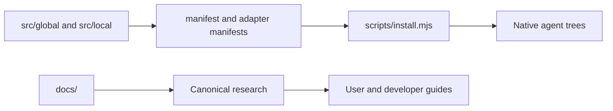

# Portable Agent Ecosystem

A portable repository for restoring a canonical agent ecosystem into native OpenCode V2, Claude Code, Codex, Cursor, Google Antigravity, and GitHub Copilot layouts.

The repository keeps one canonical source of truth in `src/`, declares native destinations in manifests, and renders the result through a cross-platform installer. GUI and CLI surfaces are handled as one shared configuration per scope rather than as duplicate installs.

Published documentation: [agents-ecosystem.helix-origin.club](https://agents-ecosystem.helix-origin.club). Project direction is tracked in [ROADMAP.md](ROADMAP.md).

## Why this exists

- Restore global and local instructions, skills, agents, commands, templates, and plugins from one source.
- Install into six agents using their native folder and manifest conventions.
- Preview every write with `--dry-run`.
- Protect existing files with timestamped backups, skip by default, and overwrite only with `--force`.
- Keep credential-bearing files out of the repository and out of installer output.

## Supported agents

| Agent | ID | Surfaces |
|---|---|---|
| OpenCode V2 | `opencode` | CLI/TUI and Desktop GUI |
| Claude Code | `claude-code` | CLI, Desktop, VS Code, JetBrains |
| Codex | `codex` | CLI, App, IDE |
| Cursor | `cursor` | Editor and CLI |
| Google Antigravity | `antigravity` | App, CLI, IDE |
| GitHub Copilot | `github-copilot` | CLI, IDE, Editor |

Native discovery paths and plugin formats are documented in [Agent native ecosystem layouts](docs/developer/research/agent-native-ecosystem-layouts.md).

## Quick start

```bash
node --check scripts/install.mjs
node scripts/install.mjs --help
node scripts/install.mjs --dry-run --agent all --scope global
node scripts/install.mjs --dry-run --agent all --scope local --project ./example-project
```

Remove `--dry-run` only when you intend to write to the resolved native destinations.

### Mixed scope

```bash
node scripts/install.mjs --dry-run \
  --global-agent opencode,codex \
  --local-agent cursor,antigravity \
  --project ./example-project
```

## Repository layout



| Path | Purpose |
|---|---|
| `src/global/` | Canonical global OpenCode ecosystem and portable assets. |
| `src/local/` | Canonical local ecosystem placeholders. |
| `manifest/` | Asset and scope declarations. |
| `adapters/` | Per-agent native layouts, plugin manifests, and component mappings. |
| `scripts/install.mjs` | Cross-platform installer. |
| `docs/user/` | Installation, scope, and troubleshooting guides. |
| `docs/developer/` | Architecture, adapter authoring, testing, and canonical research. |

## Documentation

- [Published documentation site](https://agents-ecosystem.helix-origin.club)
- [Roadmap](ROADMAP.md)
- [Privacy notice](PRIVACY.md)
- [Documentation source](docs/index.md)
- [Installation](docs/user/installation.md)
- [Scope and collision policy](docs/user/scope-and-collision-policy.md)
- [Troubleshooting](docs/user/troubleshooting.md)
- [Architecture](docs/developer/architecture.md)
- [Adapter authoring](docs/developer/adapter-authoring.md)
- [Testing](docs/developer/testing.md)
- [Developer research index](docs/developer/research/README.md)
- [GitHub Copilot and package distribution](docs/developer/research/github-copilot-and-package-distribution.md)
- [Dynamic Context Manager (DCM)](docs/developer/research/dynamic-context-manager.md)

## Safety boundaries

- Credential-bearing files are excluded before any read or copy.
- The OpenCode V2 DCM implementation (`dynamic-context-manager`) is emitted only for `opencode`; other agents receive native DCM fragments. Current context is reported separately from cumulative usage in [DCM research](docs/developer/research/dynamic-context-manager.md).
- No absolute machine path is tracked in canonical config.
- Publishing is limited to the explicitly approved GitHub Actions workflow for GitHub Package Registry; ordinary repository operations and installer dry-runs perform no remote operation or credential restore.
- DCM package version `0.1.0` is approved; no product release, tag, or changelog release section exists until a release is declared.

## Contributing

See [CONTRIBUTING.md](CONTRIBUTING.md). By participating, you agree to the [Code of Conduct](CODE_OF_CONDUCT.md). Report security issues through the process in [SECURITY.md](SECURITY.md).

## License

MIT. See [LICENSE](LICENSE).
