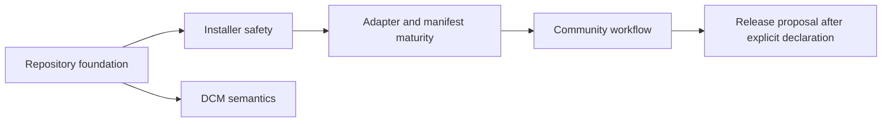

# Roadmap

Status: active development  
Last reviewed: 2026-11-25

This roadmap describes the intended direction of the portable agent ecosystem repository. It is a planning document, not a release schedule or a promise of dated delivery. No product version is assigned until a release is explicitly declared; current changes are recorded in [CHANGELOG.md](CHANGELOG.md).

Contribution expectations are in [CONTRIBUTING.md](CONTRIBUTING.md).

## Status labels

| Label | Meaning |
|---|---|
| Complete | The delivered behavior is present in the tracked repository state. |
| In progress | Files or plans exist, but verification or user-owned external setup remains. |
| Planned | Work is defined but not yet implemented in this repository. |
| Deferred | Work is intentionally out of scope for the current phase. |

## Milestones

| Milestone | Status | Outcome | Next actions |
|---|---|---|---|
| Repository foundation | Complete | Canonical source tree, six native adapter trees, manifests, root health files, license, code of conduct, security policy, support guide, and ignore rules are present. | Keep source fragments and adapted manifests aligned as native layouts evolve. |
| Installer safety | Complete | Global, local, mixed, interactive, dry-run, force, backup, and skip behavior is defined; credential-bearing paths are excluded before read or copy. | Re-run dry-run checks after installer changes. |
| DCM semantics | Complete | Current context is a newest-completed-step estimate or `unknown`; cumulative tokens and cost remain separate lifetime accounting. Native compaction remains authoritative. | Preserve the boundaries documented in [DCM research](docs/developer/research/dynamic-context-manager.md). |
| Adapter and manifest maturity | Planned | Keep per-agent native fragments authoritative and expand coverage only from verified official layouts. | Research each new destination before changing a manifest; add dry-run coverage per adapter. |
| Community workflow | Planned | Maintain issue forms, pull request template, support paths, and changelog hygiene as the repository grows. | Link policy decisions to canonical research instead of duplicating them. |
| Release proposal | Deferred | A SemVer proposal is prepared only when the user declares a release. | Keep all notes under `Unreleased` until that declaration exists. |

## Scope boundaries

- Six agents are supported through native layouts: OpenCode V2, Claude Code, Codex, Cursor, Google Antigravity, and GitHub Copilot.
- The installer renders canonical sources into native destinations; it does not maintain duplicate full agent trees.
- Existing installed agent configuration is read-only for this project. Live installation and config writes are not authorized by the roadmap.
- `service.json` and all credential-bearing files are excluded before any read, copy, log, or output.
- Docs use canonical links, GFM, ISO dates, placeholders only, and no machine-specific absolute paths.
- This roadmap does not perform a release; any version bump, tag, or GitHub Release requires explicit action.

## Documentation

- [Published documentation](https://agents-ecosystem.helix-origin.club)
- [Installation](docs/user/installation.md)
- [Scope and collision policy](docs/user/scope-and-collision-policy.md)
- [Troubleshooting](docs/user/troubleshooting.md)
- [Architecture](docs/developer/architecture.md)
- [Developer research index](docs/developer/research/README.md)
