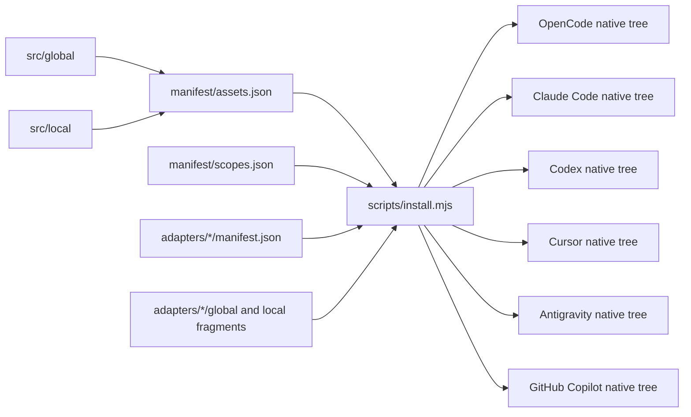
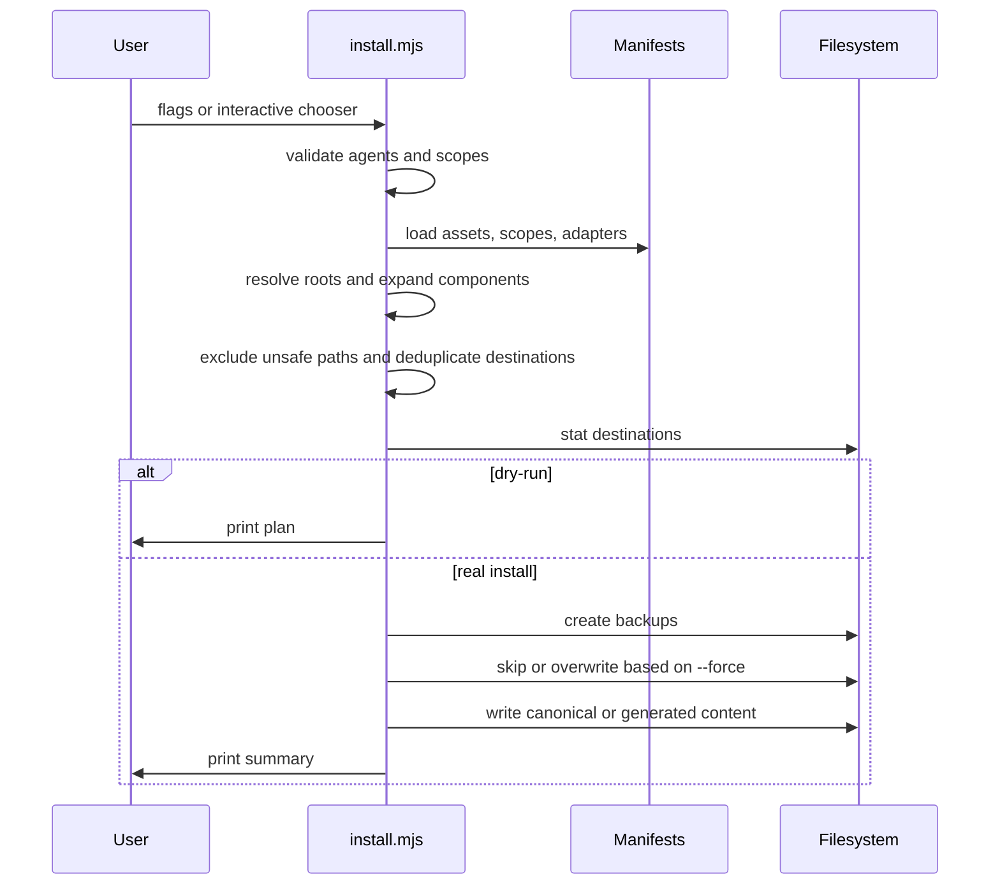

# Architecture

This repository keeps one canonical source of truth and renders it into native adapter layouts at install time. Native discovery paths and plugin rules are defined once in [Agent native ecosystem layouts](research/agent-native-ecosystem-layouts.md). DCM behavior is defined in [Dynamic Context Manager](research/dynamic-context-manager.md), and GitHub Copilot plus package-distribution limits are defined in [GitHub Copilot and GitHub Packages distribution](research/github-copilot-and-package-distribution.md).

## Goals

- Avoid duplicated full asset trees for six agents.
- Preserve each agent's native folder and manifest conventions.
- Handle GUI and CLI surfaces without writing the same config twice.
- Support global, local, and per-agent mixed scope.
- Make every write previewable with `--dry-run`.
- Exclude credential-bearing files before any read.

## Layers

| Layer | Path | Responsibility |
|---|---|---|
| Canonical source | `src/global/`, `src/local/` | Agent-neutral instructions, skills, agents, commands, templates, config, and the OpenCode V2-only plugin. |
| Manifests | `manifest/assets.json`, `manifest/scopes.json`, `adapters/<agent>/manifest.json` | Declare source units, scope roots, component mappings, plugin formats, and surfaces. |
| Native adapter fragments | `adapters/<agent>/{global,local}/` | Small native plugin manifests and generated-rule templates; no full duplicated asset trees. |
| Installer | `scripts/install.mjs` | Parse options, resolve destinations, expand components, apply exclusions, handle collisions, and write or dry-run. |
| Documentation | `docs/user/`, `docs/developer/` | User procedures and developer extension points, linked to canonical research. |

## Canonical source tree

`src/global/` contains the restored global OpenCode ecosystem:

- `config/opencode.jsonc` with portable template variables;
- `config/cli.json` with the pinned CLI plugin source;
- `config/shell-strategies.md`;
- `instructions/`, `skills/`, `agents/`, `commands/`, `templates/`;
- `plugins/dynamic-context-manager/`, which is OpenCode V2-only.

`src/local/` holds the corresponding local ecosystem folders. They are placeholders until local assets are added.

DCM reports current active context separately from cumulative session accounting; its complete status boundaries are defined in [Dynamic Context Manager](research/dynamic-context-manager.md).

Credential-bearing files are never part of the canonical tree. The exclusion rules are applied by path before any file is read.

## Manifest model

### `manifest/assets.json`

Declares canonical asset categories and exclusion patterns. It is the inventory of what may be restored.

### `manifest/scopes.json`

Declares scope names, destination-base variables, and which environment variables may be resolved at run time.

### `adapters/<agent>/manifest.json`

Declares:

- stable agent `id` and display name;
- `surfaces` list for reporting;
- `sharedConfig` flag;
- global and local destination roots;
- component mappings from canonical or adapter fragment source to native destination;
- transform name when content must be generated rather than copied unchanged;
- plugin manifest location and format.

See [Adapter authoring](adapter-authoring.md) for the schema and extension steps.

## Install pipeline

## Transformations

Not every canonical unit is copied verbatim.

| Transform | Output | Used by |
|---|---|---|
| `copy` | Byte-for-byte copy of a source file or directory. | OpenCode skills, agents, commands, templates, OpenCode config and plugin. |
| `skill-name` | Rewrites `SKILL.md` frontmatter `name` to the parent directory name for agents that require lowercase identifiers. | Non-OpenCode skill components. |
| `opencode-config` | Substitutes install-time path variables in OpenCode config. | OpenCode global and local config. |
| `agents-md` | Concatenates canonical instructions into one portable `AGENTS.md`. | Claude Code and Codex. |
| `cursor-rule` | Generates a `.mdc` rule from an instruction file. | Cursor local scope. |
| `antigravity-rule` | Generates Markdown with YAML `trigger` frontmatter. | Antigravity global and local scope. |
| `plugin-manifest` | Copies a native adapter plugin manifest into the plugin destination. | All agents except OpenCode, which uses config arrays. |

## Surface handling

Surface lists are metadata. The installer never multiplies writes by surface count. When an adapter declares `sharedConfig: true`, one destination tree is produced for the selected scope.

The OpenCode GUI plugin is an exception in form, not in scope: it is declared in the same config family while using the experimental `./gui-experimental` export. It is still written once per selected OpenCode scope.

GitHub Copilot uses native settings and fragment locations under `COPILOT_HOME` or `.github/copilot/`. Its internal `config.json` is a read-only source and is never an installer destination; see [GitHub Copilot and GitHub Packages distribution](research/github-copilot-and-package-distribution.md).

## Safety model

- Path exclusions run before reads and before destination expansion.
- Destination deduplication uses normalized absolute paths.
- Backups are timestamped and never deleted.
- `--force` is the only path to overwrite.
- `--dry-run` short-circuits before any write or backup.
- No remote operation, credential restore, or network publication is part of the architecture.

## Extension points

- Add an agent by creating an adapter manifest and native fragments, then registering the ID in the installer's adapter loader.
- Add a canonical asset by placing it under the correct `src/global/` or `src/local/` category and updating `manifest/assets.json` if a new category is needed.
- Add a transform by implementing it in the installer and declaring its name in an adapter component.

Implementation details are in [Adapter authoring](adapter-authoring.md) and [Testing](testing.md).
