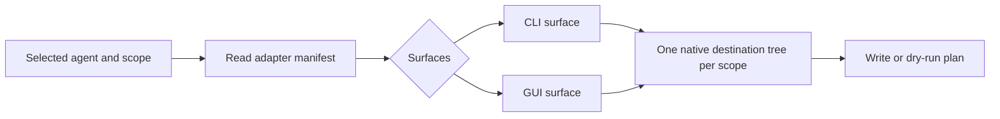
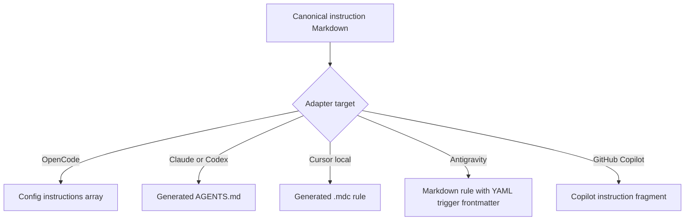

# Agent Native Ecosystem Layouts

Status: canonical research  
Last verified: 2026-11-25

This module is the single source of truth for how the supported agents discover instructions, skills, agents, commands, rules, and plugins. Other documentation links here instead of repeating these facts. DCM status semantics are defined in [Dynamic Context Manager](dynamic-context-manager.md), and Copilot/package boundaries are defined in [GitHub Copilot and GitHub Packages distribution](github-copilot-and-package-distribution.md).

## Supported agents and surface model

| Agent ID | Display name | Surfaces handled | Shared configuration per scope |
|---|---|---|---|
| `opencode` | OpenCode V2 | CLI/TUI and Desktop GUI | Config files in the OpenCode config home; GUI plugins are declared in the same config family but use an experimental export. |
| `claude-code` | Claude Code | CLI, Desktop, VS Code, JetBrains | One `~/.claude/` global tree and one project `.claude/` tree serve all surfaces. |
| `codex` | Codex | CLI, App, IDE | One Codex home (`~/.codex/` by default, relocatable with `CODEX_HOME`) and one project tree serve all surfaces. |
| `cursor` | Cursor | Editor and CLI | Skills, rules, and plugin discovery are shared by editor and CLI. |
| `antigravity` | Google Antigravity | App, CLI, IDE | Workspace `.agents/` and personal `~/.gemini/config/` trees are shared; CLI adds dedicated skill directories. |
| `github-copilot` | GitHub Copilot | CLI, IDE, editor integrations | Personal settings under `COPILOT_HOME` and project settings under `.github/copilot/` serve the documented surfaces. |

Because each agent's GUI and CLI surfaces read the same native configuration where official documentation confirms sharing, the installer writes **once per agent and scope**, not once per surface. Surfaces are recorded in adapter manifests for reporting and validation only.

## Official sources

| # | URL | Accessed | Facts supported |
|---|---|---|---|
| 1 | https://opencode.ai/docs/config/ | 2026-11-25 | Global config location, config merging, and the `instructions` and `plugins` arrays. |
| 2 | https://opencode.ai/docs/cli/config/ | 2026-11-25 | CLI settings at `~/.config/opencode/cli.json`; no project-local CLI settings file; environment overrides. |
| 3 | https://opencode.ai/docs/plugins/ | 2026-11-25 | Local plugin paths must be directories; immediate plugin package directories and direct `.ts`/`.js` files are discovered under `.opencode/plugins/`. |
| 4 | https://opencode.ai/docs/build/plugins/gui | 2026-11-25 | Desktop GUI plugins use `./gui-experimental`; `setup` runs in windows and `main` runs once. |
| 5 | https://agents.md/ | 2026-11-25 | `AGENTS.md` is the portable cross-agent instruction convention. |
| 6 | https://agentskills.io/specification | 2026-11-25 | Agent Skills require `SKILL.md` with YAML `name` and `description`; `name` must match the parent folder; optional `scripts/`, `references/`, and `assets/` folders. |
| 7 | https://code.claude.com/docs/en/skills.md | 2026-11-25 | Personal skills at `~/.claude/skills/<skill-name>/SKILL.md`; project skills at `.claude/skills/`. |
| 8 | https://code.claude.com/docs/en/sub-agents.md | 2026-11-25 | Subagents are Markdown files with frontmatter in `~/.claude/agents/` and `.claude/agents/`. |
| 9 | https://code.claude.com/docs/en/plugins.md | 2026-11-25 | Claude Code plugins bundle skills, agents, hooks, MCP servers, and commands. |
| 10 | https://code.claude.com/docs/en/plugins-reference.md | 2026-11-25 | Plugin manifest path is `.claude-plugin/plugin.json`; component paths are declared in the manifest. |
| 11 | https://code.claude.com/docs/en/platforms | 2026-11-25 | CLI, Desktop, VS Code, and JetBrains use the same underlying engine. |
| 12 | https://code.claude.com/docs/en/vs-code | 2026-11-25 | VS Code extension is the graphical interface for Claude Code in VS Code. |
| 13 | https://developers.openai.com/codex/guides/agents-md.md | 2026-11-25 | Codex reads `~/.codex/AGENTS.md` or `~/.codex/AGENTS.override.md`; `CODEX_HOME` relocates the home. |
| 14 | https://developers.openai.com/codex/config-reference.md | 2026-11-25 | User configuration is `~/.codex/config.toml`; `CODEX_HOME` overrides its location. |
| 15 | https://developers.openai.com/plugins/concepts/plugins | 2026-11-25 | ChatGPT and Codex share a plugin model with skills, optional MCP servers, and optional lifecycle hooks. |
| 16 | https://developers.openai.com/plugins/build/plugins | 2026-11-25 | Codex plugins use a portable root `plugin.json`, with `.codex-plugin/plugin.json` as a compatibility fallback. |
| 17 | https://cursor.com/docs/skills | 2026-11-25 | Agent Skills discovery from `.agents/skills/`, `.cursor/skills/`, `~/.agents/skills/`, and `~/.cursor/skills/`. |
| 18 | https://cursor.com/docs/plugins | 2026-11-25 | Cursor supports Agent Plugins and Cursor Plugins; local development uses `~/.cursor/plugins/local`. |
| 19 | https://cursor.com/docs/context/rules | 2026-11-25 | Project rules use `.cursor/rules/*.mdc`; user rules are managed in the Customize UI. |
| 20 | https://cursor.com/docs/cli | 2026-11-25 | Cursor CLI supports the same modes as the editor, including interactive and print automation. |
| 21 | https://antigravity.google/docs/customization-discovery/ | 2026-11-25 | App and CLI share `.agents/` workspace scope and `~/.gemini/config/` personal scope; CLI also reads `~/.gemini/antigravity-cli/skills/` and `~/.gemini/skills/`. |
| 22 | https://antigravity.google/docs/build-plugins/ | 2026-11-25 | Plugin folders use root `plugin.json` or `.antigravity-plugin/plugin.json`; local layout includes rules, skills, agents, hooks, and MCP config. |
| 23 | https://antigravity.google/schemas/v1/plugin.json | 2026-11-25 | Manifest keys are case-sensitive; `name` is required; `$schema` is `https://antigravity.google/schemas/v1/plugin.json`. |
| 24 | https://antigravity.google/docs/rules/ | 2026-11-25 | Rules use Markdown under `rules/` and require YAML frontmatter with a valid `trigger`. |
| 25 | https://nodejs.org/api/fs.html#fspromisescp-src-dest-options | 2026-11-25 | Node `fsPromises.cp` supports recursive cross-platform copies with overwrite control. |
| 26 | https://docs.github.com/en/copilot/reference/copilot-cli-reference/cli-config-dir-reference | 2026-11-25 | Copilot CLI config lives under `~/.copilot` or `COPILOT_HOME`; `settings.json` is JSONC, and user `agents/`, `skills/`, `hooks/`, and `instructions/` directories are documented. |
| 27 | https://docs.github.com/en/copilot/reference/plugin-and-marketplace-reference | 2026-11-25 | Copilot Agent Plugins use `plugin.json`, fixed `skills/NAME/SKILL.md`, root `mcp.json`, and `com.github.copilot/` extension files. |
| 28 | https://docs.github.com/en/copilot/reference/copilot-cli-reference/cli-plugin-reference | 2026-11-25 | Copilot CLI install specifications do not list a custom npm registry, so GitHub Packages support is not claimed for Copilot. |

## Portable source units

The canonical source tree uses agent-neutral units. Adapters translate these units into native destinations.

| Canonical unit | Source shape | Native translation |
|---|---|---|
| Instructions | Markdown files | OpenCode `instructions` config array; `AGENTS.md` for agents that use the portable convention; Antigravity rules when frontmatter is required. |
| Skills | `<name>/SKILL.md` plus optional `scripts/`, `references/`, `assets/` | Copied unchanged wherever Agent Skills are supported. |
| Agents | Markdown subagent definitions | Copied into each agent's native subagent directory. |
| Commands | Markdown command definitions | Copied into each agent's native command directory when supported. |
| Templates | Markdown or JSON templates | Copied into the adapter's template directory. |
| Plugins | Native plugin packages or native plugin manifests | Declared in native config or plugin manifest; never blindly ported across agents. |

### Agent Skills contract

A skill directory is portable only when it contains `SKILL.md` with YAML frontmatter. The `name` value must match the directory name. Optional `scripts/`, `references/`, and `assets/` directories remain inside the skill folder. The installer preserves this structure verbatim.

### `AGENTS.md` contract

`AGENTS.md` is the portable instruction convention. For agents that discover it, the installer generates the file from canonical instruction sources rather than maintaining a second hand-written copy. OpenCode instead keeps instructions in its own config array.

## Native layouts by agent

### OpenCode V2

| Scope | Native destination | Canonical input | Notes |
|---|---|---|---|
| Global | `~/.config/opencode/opencode.jsonc` | `config/opencode.jsonc` | Machine-specific paths are represented as install-time template variables, never hardcoded. |
| Global | `~/.config/opencode/cli.json` | `config/cli.json` | CLI/TUI settings; no project-local CLI settings file exists. |
| Global | `~/.config/opencode/instructions/` | `instructions/` | Declared by the `instructions` array in `opencode.jsonc`. |
| Global | `~/.config/opencode/skills/`, `agents/`, `commands/`, `templates/` | Matching canonical folders | Copied as native OpenCode assets. |
| Global | `~/.config/opencode/plugins/dynamic-context-manager/` | `plugins/dynamic-context-manager/` | OpenCode V2-only DCM implementation; other agents receive native DCM fragments. |
| Local | `<project>/.opencode/` | Matching canonical local folders | Project-local config and assets; CLI settings remain global. |

OpenCode Desktop GUI plugins use the experimental `./gui-experimental` package export. The CLI plugin source is declared in `cli.json` and is pinned in the canonical config. Configured local plugin paths must point to directories.

> **OpenCode V2 boundary:** `dynamic-context-manager` imports OpenCode V2 plugin modules and exposes OpenCode-specific tools and status surfaces. It is not a portable plugin implementation and must not be copied or rewritten for Claude Code, Codex, Cursor, Antigravity, or Copilot. Other agents receive native DCM fragments; current-versus-cumulative status semantics are defined in [Dynamic Context Manager](dynamic-context-manager.md).

### Claude Code

| Scope | Native destination | Canonical input | Notes |
|---|---|---|---|
| Global | `~/.claude/AGENTS.md` | All canonical instructions | Generated once; all surfaces read the same global tree. |
| Global | `~/.claude/skills/` | `skills/` | Personal skills. |
| Global | `~/.claude/agents/` | `agents/` | Personal subagents. |
| Global | `~/.claude/commands/` | `commands/` | Personal commands. |
| Global | `~/.claude/plugins/agent-ecosystem/.claude-plugin/plugin.json` | Adapter plugin manifest | Declares bundled components. |
| Local | `<project>/.claude/` | Local canonical folders plus generated `AGENTS.md` | Project skills, agents, commands, and plugin manifest. |

CLI, Desktop, VS Code, and JetBrains share the underlying engine and the same user-local configuration. The installer therefore writes a single global tree and a single project tree.

### Codex

| Scope | Native destination | Canonical input | Notes |
|---|---|---|---|
| Global | `<codex-home>/AGENTS.md` | All canonical instructions | `<codex-home>` is `~/.codex` unless `CODEX_HOME` is set. |
| Global | `<codex-home>/config.toml` | Adapter template | Minimal native config; relocation is resolved at install time and never hardcoded into tracked assets. |
| Global | `<codex-home>/plugins/agent-ecosystem/plugin.json` | Adapter plugin manifest | Plugin root manifest; skill components are copied beside it. |
| Global | `<codex-home>/plugins/agent-ecosystem/skills/` | `skills/` | Portable Agent Skills. |
| Local | `<project>/.codex/` | Local canonical folders and generated `AGENTS.md` | Project-local instruction and component tree. |

Codex CLI, App, and IDE surfaces share the configured Codex home. The installer resolves `CODEX_HOME` at run time.

### Cursor

| Scope | Native destination | Canonical input | Notes |
|---|---|---|---|
| Global | `~/.cursor/skills/` | `skills/` | Also discoverable through `~/.agents/skills/`; the installer chooses one canonical global destination to avoid duplication. |
| Global | `~/.cursor/plugins/local/agent-ecosystem/.cursor-plugin/plugin.json` | Adapter plugin manifest | Local plugin development location. |
| Local | `<project>/.cursor/rules/*.mdc` | Canonical instructions | Project rules in native Cursor rule format. |
| Local | `<project>/.cursor/skills/` | `skills/` | Project Agent Skills. |
| Local | `<project>/.cursor/agents/` | `agents/` | Project agents. |
| Local | `<project>/.cursor/commands/` | `commands/` | Project commands. |

Cursor user rules are managed in the Customize UI rather than a documented file path, so the installer does not silently create them at global scope. Project rules use `.mdc` files.

### Google Antigravity

| Scope | Native destination | Canonical input | Notes |
|---|---|---|---|
| Global | `~/.gemini/config/rules/*.md` | Canonical instructions converted to rules | Each rule requires YAML frontmatter with a valid `trigger`. |
| Global | `~/.gemini/config/skills/` | `skills/` | Personal scope shared by App and CLI. |
| Global | `~/.gemini/config/plugins/agent-ecosystem/.antigravity-plugin/plugin.json` | Adapter plugin manifest | `$schema` and `name` are required; keys are case-sensitive. |
| Local | `<project>/.agents/rules/*.md` | Canonical instructions converted to rules | Workspace scope shared by App and CLI. |
| Local | `<project>/.agents/skills/` | `skills/` | Workspace skills. |
| Local | `<project>/.agents/agents/` | `agents/` | Workspace agents. |
| Local | `<project>/.agents/plugins/agent-ecosystem/.antigravity-plugin/plugin.json` | Adapter plugin manifest | Local plugin manifest. |

Valid Antigravity rule triggers are `model_decision`, `always_on`, `glob`, and `manual`. The installer defaults generated rules to `model_decision` unless an adapter declares otherwise.

### GitHub Copilot

| Scope | Native destination | Canonical input | Notes |
|---|---|---|---|
| Global | `COPILOT_HOME/settings.json` | Adapter settings fragment | JSONC settings snippet; merged only as a fragment. |
| Global | `COPILOT_HOME/agents/`, `COPILOT_HOME/skills/`, `COPILOT_HOME/hooks/`, `COPILOT_HOME/instructions/` | Matching canonical folders | Documented personal configuration directories. |
| Local | `<project>/.github/copilot/settings.json` | Adapter settings fragment | Project settings candidate; no credential values. |
| Local | `<project>/.github/copilot/settings.local.json` | Adapter settings fragment | Personal local override candidate; never a credential store. |
| Plugin | `plugin.json`, `skills/NAME/SKILL.md`, `mcp.json`, `com.github.copilot/` | Adapter plugin fragments | Native Agent Plugin layout only; no fabricated component arrays. |

`COPILOT_HOME` defaults to `~/.copilot` and relocates the CLI config home. Personal configuration takes precedence over repository-local configuration. Copilot internal `config.json` and installed-plugin state are read-only sources and are never installer destinations. GitHub Packages distribution is not claimed for Copilot; see [GitHub Copilot and GitHub Packages distribution](github-copilot-and-package-distribution.md).

## Destination resolution

The installer resolves destinations from environment and scope inputs at run time:

| Variable | Used by | Resolution |
|---|---|---|
| `OPENCODE_CONFIG_HOME` | OpenCode | Defaults to the platform config home plus `opencode`; may be overridden. |
| `XDG_CONFIG_HOME` | OpenCode, Antigravity | Standard base directory when set; otherwise the platform default. |
| `CODEX_HOME` | Codex | Defaults to the user home plus `.codex`; may be overridden. |
| `COPILOT_HOME` | GitHub Copilot | Defaults to the user home plus `.copilot`; may be overridden. |
| Project root | All agents | `--project` when supplied; otherwise the current working directory. |

No absolute user path is stored in tracked assets. Native config templates use placeholders that are substituted during installation.

## Collision and exclusion boundary

- Existing files are backed up before any change.
- By default, an existing destination is skipped and its backup is reported.
- `--force` permits overwrite after the same backup step.
- A single destination is written at most once per agent and scope, even when multiple surfaces are reported.
- Credential-bearing files are never read, copied, logged, or emitted. The exclusion list is applied to paths before any filesystem read.
- Files whose names indicate environment values, cookies, credentials, secrets, tokens, or passwords are excluded by path pattern.

## Portability constraints

- The installer uses built-in `node:` modules only.
- Copies use recursive platform-aware filesystem operations.
- Path construction uses the platform path API; tracked assets use forward-slash logical paths.
- GUI and CLI surfaces are reported, not installed separately, when official documentation confirms shared config.
- Machine-specific statements and absolute paths are normalized out of canonical assets.
