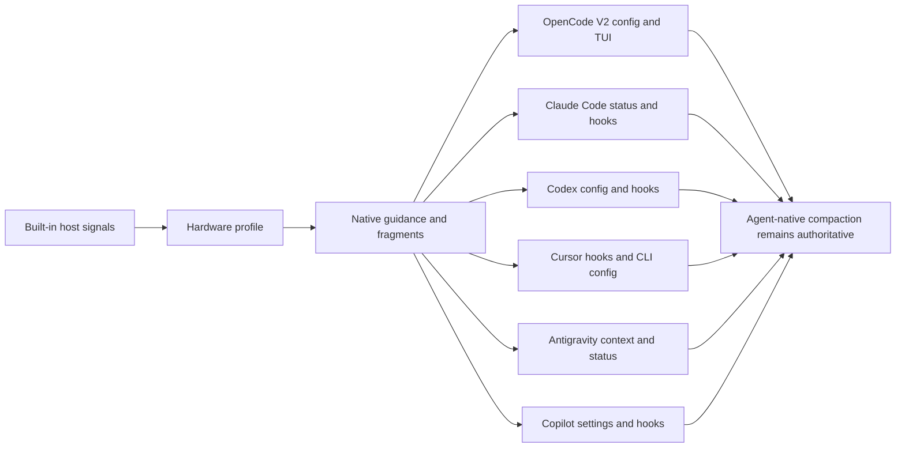
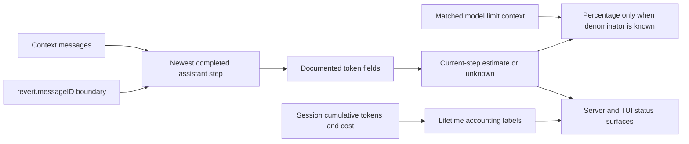

# Dynamic Context Manager (DCM)

Status: canonical research  
Last verified: 2026-11-25

`DCM` is the display name; `dynamic-context-manager` is the full identifier. DCM is a hardware-aware enhancement layer that improves context visibility and gives per-agent guidance around each supported agent's native context and compaction behavior. It does not replace native compaction, does not run compaction automatically, and does not guarantee UI responsiveness on any hardware.

Agent discovery paths and plugin formats are defined in [Agent native ecosystem layouts](agent-native-ecosystem-layouts.md). Capability layer boundaries are defined in [Portable capability scaffolds](portable-capability-scaffolds.md).

## Official sources

| # | URL | Accessed | Facts supported |
|---|-----|----------|-----------------|
| 1 | https://opencode.ai/docs/compaction/ | 2026-11-25 | OpenCode V2 native compaction supports `auto`, `keep.tokens`, `buffer`, `background`, model overrides, and an explicit compact API. |
| 2 | https://opencode.ai/docs/build/plugins/cli/ | 2026-11-25 | OpenCode TUI plugins can read `context.data.session.get/cost/status/message.list`, open panels, render `home.footer.status` and `session.panel` contributions, and define slash commands and keymaps. No exact context-size API is documented. |
| 3 | https://opencode.ai/docs/config/ | 2026-11-25 | OpenCode config is JSONC; relative instruction paths and globs are supported; `{{OPENCODE_CONFIG_HOME}}` is not a documented token. |
| 4 | https://opencode.ai/docs/cli/ | 2026-11-25 | CLI settings are global-only under the OpenCode config home. |
| 5 | https://code.claude.com/docs/llms.txt | 2026-11-25 | Official Claude Code documentation index. |
| 6 | https://code.claude.com/docs/en/context-window.md | 2026-11-25 | Claude Code native context includes instructions, memory, skills, MCP metadata, and file reads; compaction happens natively during a session. |
| 7 | https://code.claude.com/docs/en/statusline.md | 2026-11-25 | Claude Code status lines receive JSON including context window, cost, cache, and rate limits across terminal, IDE, and desktop. |
| 8 | https://code.claude.com/docs/en/hooks.md | 2026-11-25 | Claude Code supports `PreCompact` and `PostCompact` lifecycle hooks. |
| 9 | https://code.claude.com/docs/en/model-config.md | 2026-11-25 | Claude Code model configuration includes native auto-compact controls. |
| 10 | https://code.claude.com/docs/en/prompt-caching.md | 2026-11-25 | Prompt cache reuse changes with model, tools, plugins, and context-affecting inputs. |
| 11 | https://learn.chatgpt.com/llms.txt | 2026-11-25 | Official Codex documentation index. |
| 12 | https://learn.chatgpt.com/docs/config-file/config-reference.md | 2026-11-25 | Codex exposes native auto-compact thresholds and hooks configuration; `features.context_management.experimental_mode` is not currently available. |
| 13 | https://learn.chatgpt.com/docs/hooks.md | 2026-11-25 | Codex hooks support `PreCompact` and `PostCompact` from native config locations. |
| 14 | https://cursor.com/docs/llms.txt | 2026-11-25 | Official Cursor documentation index. |
| 15 | https://cursor.com/docs/cli/reference/slash-commands.md | 2026-11-25 | Cursor CLI includes `/summarize` and `/compress` native context commands. |
| 16 | https://cursor.com/docs/hooks.md | 2026-11-25 | Cursor supports `preCompact` hooks with JSON stdin/stdout payloads. |
| 17 | https://cursor.com/docs/cli/reference/configuration.md | 2026-11-25 | Cursor CLI configuration uses `~/.cursor/cli-config.json`. |
| 18 | https://antigravity.google/llms.txt | 2026-11-25 | Official Antigravity documentation index. |
| 19 | https://antigravity.google/docs/cli/commands/context.md | 2026-11-25 | Antigravity `/context` shows native context usage and compaction checkpoints. |
| 20 | https://antigravity.google/docs/commands/compact.md | 2026-11-25 | Antigravity `/compact` creates a native structured checkpoint. |
| 21 | https://antigravity.google/docs/cli/statusline.md | 2026-11-25 | Antigravity CLI status lines receive JSON context state. |
| 22 | https://antigravity.google/schemas/v1/plugin.json | 2026-11-25 | Antigravity plugin schema is closed; unsupported keys must not be emitted. |
| 23 | https://docs.github.com/en/copilot/reference/copilot-cli-reference/cli-plugin-reference | 2026-11-25 | Copilot `preCompact` is notification-only and cannot replace native compaction. |
| 24 | https://docs.github.com/en/copilot/reference/copilot-cli-reference/cli-config-dir-reference | 2026-11-25 | Copilot CLI config, hooks, instructions, agents, and skills have documented native locations. |
| 25 | https://nodejs.org/api/os.html | 2026-11-25 | Node.js exposes portable host signals through built-in `os` APIs; `os.loadavg()` is always `[0, 0, 0]` on Windows. |
| 26 | https://opencode.ai/docs/build/plugins/server/ | 2026-11-25 | Server plugins can read sessions and context messages, request native compaction with queued delivery, hook native context/compaction stages, subscribe to events, transform tools, and assert permissions. `ctx.session.context()` returns messages, not a token count. |
| 27 | https://opencode.ai/docs/build/plugins/gui/ | 2026-11-25 | GUI plugins add panels, commands, and settings through the experimental `./gui-experimental` export; no context-size API is documented. |
| 28 | https://opencode.ai/docs/openapi.json | 2026-11-25 | Public session endpoints expose cumulative token and cost accounting plus session status; no current context-window size or headroom field is published. |
| 29 | https://github.com/anomalyco/opencode/issues/30649 | 2026-11-25 | Session-level cumulative `tokens.cache.read` can grow unbounded; upstream discussion separates billing/usage totals from effective-context accounting and identifies the last assistant message as the native compaction input. |
| 30 | https://api.github.com/repos/anomalyco/opencode/issues/30649/comments | 2026-11-25 | Upstream comments confirm `cache.read` is not the context window and cumulative session counters can dominate displayed totals. |
| 31 | https://github.com/anomalyco/opencode/issues/36515 | 2026-11-25 | A Desktop report showed cumulative session tokens did not drop after `/compact`, while an occupancy percentage computed from the last assistant message did drop. |
| 32 | https://github.com/anomalyco/opencode/issues/36262 | 2026-11-25 | The session endpoint provides cumulative token fields but no current effective-context size, headroom, or post-compaction size. |
| 33 | https://github.com/anomalyco/opencode/issues/57216 | 2026-11-25 | `ctx.session.contextSize()` appears only as a feature request and must not be used as an existing API. |
| 34 | https://github.com/anomalyco/opencode/issues/64488 | 2026-11-25 | Context percentages above 100% were traced to cumulative session tokens being mistaken for live context occupancy. |
| 35 | https://github.com/anomalyco/opencode/issues/34712 | 2026-11-25 | Reported input-token/context-indicator inconsistencies further distinguish cumulative accounting from current occupancy. |
| 36 | https://raw.githubusercontent.com/angeloper86/opencode-context-usage/main/README.md | 2026-11-25 | Third-party status displays separate “Context window (last request)” from “Session total,” corroborating the distinction without supplying a supported plugin API. |
| 37 | https://raw.githubusercontent.com/sechlol/opencode-context-info/main/README.md | 2026-11-25 | Third-party plugins describe occupancy as an estimate from the last completed step's prompt size versus the model limit, not an authoritative measurement. |

## Design boundary

DCM must never:

- replace an agent's native compaction mechanism;
- invoke compaction automatically or without explicit request;
- duplicate the summarization work performed by native compaction;
- claim that a UI cannot lock up or that responsiveness is guaranteed;
- invent unsupported configuration keys or plugin manifest fields;
- bundle binaries, dependencies, credentials, or host-specific paths.

## Hardware signals

Hardware profiles derive only from built-in Node.js `os` APIs:

- logical core count, including `os.availableParallelism()` where available;
- total and free memory;
- platform, architecture, and machine identifier;
- load average, with the Windows zero-value caveat.

Signals are translated into conservative guidance such as earlier native compaction, smaller recent-context tails, and lighter status output. They are not used to decide that automatic native behavior should be disabled unless the user's native config already says so.

## Current context versus cumulative accounting

No supported OpenCode plugin API returns exact current context occupancy or headroom. `ctx.session.context()` returns context **messages**, and the proposed `ctx.session.contextSize()` exists only in an upstream feature request; DCM must not call it.

- The current estimate scans messages newest-to-oldest, uses only completed assistant messages, and stops at `Session.Info.revert.messageID`. It sums only the documented `input`, `output`, `reasoning`, `cache.read`, and `cache.write` token fields from that step.
- The estimate is labeled with its source, normally `last-assistant-step`. If no trustworthy step token data exists, current context is `unknown`; it never falls back to a cumulative total or to `0` presented as a measurement.
- Cumulative session token totals are lifetime accounting. They include `cache.read`, grow across turns, and can exceed a model window by orders of magnitude. They are valid for usage reporting but invalid as current context, headroom, or a current-context percentage.
- Cost is also cumulative lifetime accounting. It must carry its own label and must never be rendered as a `ctx` gauge.
- `cache.read` is included only inside the last completed step's request accounting. It is never shown as a standalone current-context gauge.
- An occupancy percentage uses only a finite positive `limit.context` matched by both `providerID` and model `id`. Without that denominator the status view says the denominator is unknown and omits the percentage.
- The local `90000` hard ceiling, `80000` compact threshold, `8000` recent-token target, and `60%` buffer are policy guidance and suggested values, not model limits or authoritative native headroom.
- The estimate is a conservative visibility aid because native compaction reads the last assistant message; it is not an authoritative context-window measurement.

## Status surfaces and controls

| Surface | Identifier | Behavior |
|---|---|---|
| Server tool | `dcm.status` | Returns the complete status snapshot described below. |
| Server compatibility alias | `dcm.usage` | Returns the same snapshot and keeps earlier call sites working. |
| Server context note | `<context key="dynamic-context-manager">` | Places the complete human-readable snapshot into the active context without changing native compaction behavior. |
| TUI session panel | `dynamic-context-manager.status` | Renders complete status rows through `session.panel`. |
| TUI command | `/dcm-status` | Opens the panel; no default keybind is assigned. |
| TUI footer | `home.footer.status` | Shows `ctx N (step)` for an estimate or `ctx ?` when unknown; cost never appears as a `ctx` gauge. |
| Explicit control | `dcm.compact` | Queues native compaction only on explicit request and reports pending state; DCM never summarizes the session itself. |
| Opt-in controls | `dcm.setup`, `dcm.configure` | Change selected native compaction values only after a verified backup and explicit approval. |

A complete status view reports current context and its estimate source; matched model limit and percentage when available; cumulative tokens and cost labeled as lifetime accounting; session status; hardware tier and signals; local policy and tier-specific suggested values; setup/configuration state; pending native compaction; and the authority boundary that native compaction remains authoritative and DCM never auto-compacts. The TUI cannot read the server's global configuration, so its setup/config row reports that limitation and directs the user to `dcm.status`.

## Per-agent native surfaces

| Agent | Native DCM surface | Constraint |
|---|---|---|
| OpenCode V2 | Global config `compaction` values, session usage data, and TUI status slots. Keep the plugin directory under the OpenCode plugin path and preserve native auto/manual compaction. | CLI settings are global-only; relative config paths are preferred. |
| Claude Code | Status-line JSON, model/auto-compact config, prompt-cache awareness, and `PreCompact`/`PostCompact` hooks. | One global tree and one project tree serve all surfaces; do not duplicate surface-specific config. |
| Codex | Documented config keys and `PreCompact`/`PostCompact` hooks. | Do not emit unavailable experimental context-management keys. Registry marketplace snippets are documentation/fragment-only. |
| Cursor | `/summarize`, `/compress`, `preCompact` hooks, plugin roots, and CLI config. | Hook fragments must be valid JSON stdin/stdout commands; account for PowerShell on Windows desktop. |
| Google Antigravity | `/context`, native `/compact`, CLI status-line JSON, and closed-schema plugin manifests. | Emit only fields allowed by the current schema. |
| GitHub Copilot | Native settings JSONC, user/project instructions, agents, skills, hooks, and plugin fragments. | `preCompact` is notification-only; internal `config.json` is not an install target. |

## Installer and fragment policy

DCM fragments are emitted by the portable installer as native files only. Existing files are backed up and skipped by default; overwrite requires explicit `--force`. Destinations are deduplicated so shared GUI and CLI surfaces receive one write per scope.

Credential-bearing service configuration is excluded from the repository, installer, scans, logs, and output. DCM fragments contain no secrets, tokens, cookies, `.env` values, usernames, passwords, webhook URLs, binary payloads, or absolute host paths.

## Verification

- Validate generated config against each agent's documented schema or config reference.
- Confirm native compaction remains enabled and explicit-only controls stay explicit.
- Confirm no unsupported key is emitted for closed-schema plugin formats.
- Confirm Windows host-signal caveats are represented without host-specific paths.
- Confirm dry-run output contains no credential-bearing service config.
