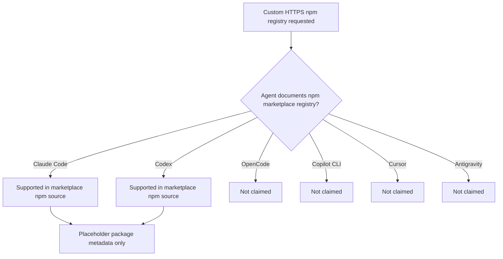

# GitHub Copilot and GitHub Packages Distribution

Status: canonical research  
Last verified: 2026-11-25

This module is the single source of truth for GitHub Copilot native adapter locations and for the boundaries of GitHub Packages plugin distribution. Agent discovery paths and plugin formats are defined in [Agent native ecosystem layouts](agent-native-ecosystem-layouts.md); DCM-specific behavior is defined in [Dynamic Context Manager](dynamic-context-manager.md).

## Official sources

| # | URL | Accessed | Facts supported |
|---|-----|----------|-----------------|
| 1 | https://opencode.ai/docs/plugins/ | 2026-11-25 | OpenCode plugin config supports published, versioned, scoped, local-directory, and file entries, but documented `plugin add` examples do not list custom npm registry specifications. |
| 2 | https://docs.claude.com/en/docs/claude-code/plugins | 2026-11-25 | Claude Code plugins bundle skills, agents, hooks, MCP servers, and commands. |
| 3 | https://docs.claude.com/en/docs/claude-code/plugin-marketplaces | 2026-11-25 | Claude Code marketplaces are catalogs with plugin entries and source information. |
| 4 | https://code.claude.com/docs/en/plugins/marketplace-reference.md | 2026-11-25 | Claude Code npm marketplace entries support `package`, `version`, and `registry`; custom registries must use HTTPS unless a user-configured default exists. |
| 5 | https://developers.openai.com/codex/plugins/ | 2026-11-25 | Codex uses the portable Agent Plugins model for skills, optional MCP servers, and optional lifecycle hooks. |
| 6 | https://developers.openai.com/plugins/build/plugins | 2026-11-25 | Codex marketplace npm sources support `package`, `version`, and HTTPS `registry`; registry values must not embed credentials, query strings, or fragments. |
| 7 | https://docs.github.com/en/copilot/reference/copilot-cli-reference/cli-plugin-reference | 2026-11-25 | Copilot CLI install specifications are `plugin@marketplace`, `OWNER/REPO`, `OWNER/REPO:PATH/TO/PLUGIN`, Git URL, or local path; npm registry specifications are not listed. |
| 8 | https://docs.github.com/en/copilot/reference/copilot-cli-reference/cli-config-dir-reference | 2026-11-25 | Copilot CLI config lives under `~/.copilot` or `COPILOT_HOME`; `settings.json` is JSONC; `config.json` is internal state; user `agents/`, `skills/`, `hooks/`, and `instructions/` directories are documented. |
| 9 | https://docs.github.com/en/copilot/reference/plugin-and-marketplace-reference | 2026-11-25 | Copilot Agent Plugins use `plugin.json`, fixed `skills/NAME/SKILL.md`, root `mcp.json`, and `com.github.copilot/` extension files. |
| 10 | https://docs.github.com/en/packages/working-with-a-github-packages-registry/working-with-the-npm-registry | 2026-11-25 | GitHub Packages npm registry is `https://npm.pkg.github.com`; package names are lowercase scoped `@NAMESPACE/PACKAGE-NAME`; authentication is required. |
| 11 | https://docs.npmjs.com/cli/v11/configuring-npm/npmrc | 2026-11-25 | npm supports `.npmrc` files, `${VARIABLE_NAME}` substitution, and registry-scoped auth keys. |
| 12 | https://nodejs.org/api/os.html | 2026-11-25 | Node exposes portable host signals through built-in `os` APIs. |

## GitHub Copilot native adapter

Copilot is a native sixth adapter. Its configuration home is `~/.copilot` by default and may be relocated with `COPILOT_HOME`. Personal configuration takes precedence over repository-local configuration.

| Scope | Native location | Installer use |
|---|---|---|
| Global | `COPILOT_HOME/settings.json` | JSONC settings snippet, merged only as a fragment. |
| Global | `COPILOT_HOME/agents/`, `skills/`, `hooks/`, `instructions/` | Portable canonical assets copied as native fragments. |
| Local | `.github/copilot/settings.json` | Project settings candidate. |
| Local | `.github/copilot/settings.local.json` | Personal local override candidate; never a credential store. |
| Plugin | `plugin.json`, `skills/NAME/SKILL.md`, `mcp.json`, `com.github.copilot/` | Native Agent Plugin layout only; no fabricated component arrays. |

Copilot's internal `config.json` and installed-plugin state are read-only sources and are never installer destinations. Copilot `preCompact` can notify and inject context, but it cannot replace native `/compact` or automatic CLI compaction.

Plugin agents and skills are first-found-wins; MCP servers are last-wins. Fragment generation must respect those discovery rules rather than attempting to merge unrelated plugin trees.

## GitHub Packages support matrix

| Agent | GitHub Packages plugin distribution | Reason |
|---|---|---|
| Claude Code | Supported through marketplace npm source | `registry`, `package`, and `version` fields are documented. |
| Codex | Supported through marketplace npm source | HTTPS `registry` npm sources are documented for Agent Plugins. |
| OpenCode V2 | Not claimed | Documented plugin add examples do not include custom npm registry specifications. |
| GitHub Copilot CLI | Not claimed | Install specifications are marketplace, repository, Git URL, or local path. |
| Cursor | Not claimed | No documented GitHub Packages plugin installation specification. |
| Google Antigravity | Not claimed | No documented GitHub Packages plugin installation specification. |

## Placeholder package policy

The repository may contain an unpublished skeleton with placeholder scoped names such as `@NAMESPACE/PACKAGE-NAME` and the documented public registry URL `https://npm.pkg.github.com`. It must not contain:

- tokens, credentials, webhook URLs, cookies, `.env` values, usernames, or passwords;
- a real namespace or published package version;
- install scripts that perform network operations;
- claims that unsupported agents can install from GitHub Packages;
- remote operations, tags, publishing commands, or release assignments.

Authentication belongs in user-managed npm configuration using variable substitution and registry-scoped auth keys; no secret value belongs in tracked files or installer output.

## Verification

- Confirm every Copilot fragment uses a documented native location.
- Confirm Copilot `config.json` is never an installer destination.
- Confirm GitHub Packages is claimed only for Claude Code and Codex marketplace sources.
- Confirm package skeleton values are placeholders and contain no secrets or network commands.
