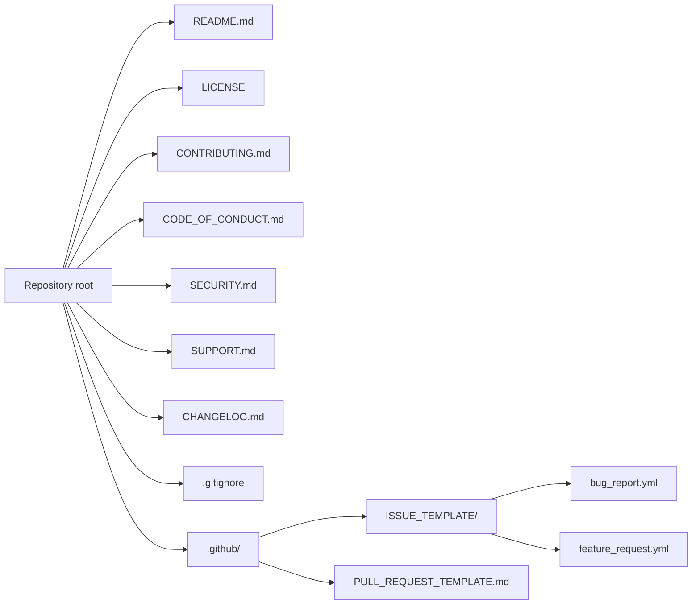
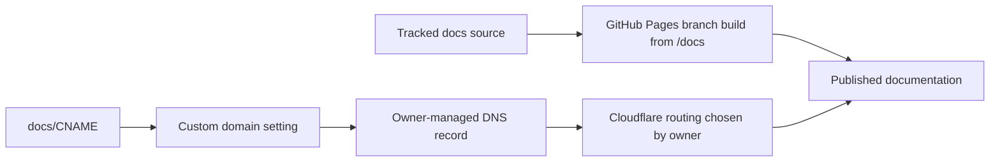

# GitHub Repository Foundations

Status: canonical research  
Last verified: 2026-11-25

This module is the single source of truth for repository-level files, community health conventions, licensing, issue templates, and ignore rules. Other documentation links here instead of repeating these facts.

## Official sources

| # | URL | Accessed | Facts supported |
|---|---|---|---|
| 1 | https://docs.github.com/en/communities/setting-up-your-project-for-healthy-contributions/about-community-profiles-for-public-repositories | 2026-11-25 | Community profiles check README, LICENSE, CONTRIBUTING, CODE_OF_CONDUCT, SECURITY, SUPPORT, and issue templates. |
| 2 | https://docs.github.com/en/communities/setting-up-your-project-for-healthy-contributions/creating-a-default-community-health-file | 2026-11-25 | Health files may be placed in `.github/`, repository root, or `docs/` with defined precedence; licenses are per repository. |
| 3 | https://docs.github.com/en/get-started/getting-started-with-git/ignoring-files | 2026-11-25 | A root `.gitignore` should be created and shared with clones. |
| 4 | https://docs.github.com/en/repositories/managing-your-repositorys-settings-and-features/customizing-your-repository/about-readmes | 2026-11-25 | README is surfaced from `.github/`, root, or `docs/`; root is a valid landing page location. |
| 5 | https://docs.github.com/en/repositories/managing-your-repositorys-settings-and-features/customizing-your-repository/licensing-a-repository | 2026-11-25 | License text should be placed in a root `LICENSE.txt`, `LICENSE.md`, or equivalent file. |
| 6 | https://docs.github.com/en/communities/using-templates-to-encourage-useful-issues-and-pull-requests/about-issue-and-pull-request-templates | 2026-11-25 | Issue templates and issue forms live in `.github/ISSUE_TEMPLATE`; PR templates may live in root, `docs/`, or `.github/`. |
| 7 | https://docs.github.com/en/communities/setting-up-your-project-for-healthy-contributions/setting-guidelines-for-repository-contributors | 2026-11-25 | `CONTRIBUTING.md` is surfaced when users open issues or pull requests. |
| 8 | https://docs.github.com/en/communities/setting-up-your-project-for-healthy-contributions/adding-a-code-of-conduct-to-your-project | 2026-11-25 | `CODE_OF_CONDUCT.md` is recognized; adapted standards should preserve attribution. |
| 9 | https://docs.github.com/en/code-security/how-tos/report-and-fix-vulnerabilities/configure-vulnerability-reporting/add-security-policy | 2026-11-25 | `SECURITY.md` communicates supported versions and vulnerability reporting instructions. |
| 10 | https://docs.github.com/en/communities/setting-up-your-project-for-healthy-contributions/adding-support-resources-to-your-project | 2026-11-25 | `SUPPORT.md` is linked from the issue creation experience. |
| 11 | https://keepachangelog.com/en/1.1.0/ | 2026-11-25 | Changelogs use an `Unreleased` section, grouped change types, ISO dates, and no invented release versions. |
| 12 | https://www.contributor-covenant.org/version/2/1/code_of_conduct/ | 2026-11-25 | Contributor Covenant v2.1 full text and enforcement guideline levels. |
| 13 | https://opensource.org/license/mit | 2026-11-25 | MIT License text and permissive terms. |
| 14 | https://docs.github.com/en/pages/getting-started-with-github-pages/configuring-a-publishing-source-for-your-github-pages-site | 2026-11-25 | GitHub Pages can publish from a branch, including `/docs`, and branch publishing stores the custom domain in a root `CNAME` file. |
| 15 | https://docs.github.com/en/pages/configuring-a-custom-domain-for-your-github-pages-site/managing-a-custom-domain-for-your-github-pages-site | 2026-11-25 | Subdomains use a CNAME to the GitHub Pages domain; GitHub recommends adding the custom domain in settings before DNS. |
| 16 | https://docs.github.com/en/pages/getting-started-with-github-pages/securing-your-github-pages-site-with-https | 2026-11-25 | GitHub Pages supports HTTPS and enforcement for correctly configured custom domains; incorrect DNS can block certificate issuance. |
| 17 | https://just-the-docs.github.io/just-the-docs/docs/configuration/ | 2026-11-25 | `just-the-docs` supports documentation navigation, search, auxiliary links, GitHub edit links, and Mermaid configuration. |
| 18 | https://developers.cloudflare.com/dns/proxy-status/ | 2026-11-25 | Cloudflare can proxy A, AAAA, and CNAME records; DNS-only records return the origin address directly. |
| 19 | https://developers.cloudflare.com/ssl/origin-configuration/ssl-modes/ | 2026-11-25 | Cloudflare SSL modes are Off, Flexible, Full, and Full (strict); Full (strict) validates the origin certificate. |
| 20 | https://docs.github.com/en/site-policy/privacy-policies/github-privacy-statement | 2026-11-25 | GitHub processes platform data under its own privacy statement. |
| 21 | https://www.cloudflare.com/privacypolicy/ | 2026-11-25 | Cloudflare processes customer-property interaction and traffic routing data under its own privacy policy. |

## Approved root file set

| File | Purpose | Placement rationale |
|---|---|---|
| `.gitignore` | Exclude local-only, credential-bearing, cache, and generated artifacts. | GitHub recommends a committed root ignore file so all clones share it. |
| `README.md` | Project landing page, quick start, scope overview, and documentation links. | Root is a supported and conventional README location. |
| `CHANGELOG.md` | Track notable changes under `Unreleased` until a release is declared. | Conventional project tracking file; no release version is invented. |
| `ROADMAP.md` | Communicate milestone status, direction, and scope boundaries without assigning release dates or versions. | Root project documentation is a conventional location for vision and planning. |
| `PRIVACY.md` | State the repository's own data-handling boundaries and link to platform notices. | Root project documentation is visible to contributors and complements platform-level policies. |
| `CONTRIBUTING.md` | Explain development workflow, validation commands, and review expectations. | Root is supported and surfaced during issue and pull request creation. |
| `CODE_OF_CONDUCT.md` | Contributor Covenant v2.1 community standard. | Root is recognized by GitHub; attribution is preserved. |
| `SECURITY.md` | Supported status and safe vulnerability reporting guidance. | Root is a supported health-file location. |
| `SUPPORT.md` | Where to ask questions and what information to include. | Root is supported and linked from the issue creation experience. |
| `LICENSE` | MIT License text. | A license file belongs in the individual repository. |
| `.github/ISSUE_TEMPLATE/bug_report.yml` | Structured bug report issue form. | Issue forms live under `.github/ISSUE_TEMPLATE`. |
| `.github/ISSUE_TEMPLATE/feature_request.yml` | Structured feature request issue form. | Issue forms live under `.github/ISSUE_TEMPLATE`. |
| `.github/PULL_REQUEST_TEMPLATE.md` | Pull request checklist and description scaffold. | Root, `docs/`, or `.github/` are supported; `.github/` keeps templates grouped. |

## Repository discovery

## Roadmap and privacy boundary

- `ROADMAP.md` is a milestone plan with status labels. It is not a dated delivery commitment or a release schedule.
- Roadmap milestones link to canonical research and changelog state instead of repeating technical facts.
- `PRIVACY.md` covers only this repository's own behavior: no installer telemetry, no credential restore, no secret collection, and exclusion of credential-bearing files before read or copy.
- The repository notice does not govern GitHub or Cloudflare processing. It links to each provider's own policy for platform-level data.
- Third-party links and issue submissions remain subject to the destination service's terms and the contributor's own redaction choices.

## Documentation publication

The approved documentation source is the repository's `docs/` directory with `just-the-docs` as a remote Jekyll theme. The tracked `docs/CNAME` file names `HELIX-Origin-Dev.github.io`, and the intended custom domain is `agents-ecosystem.helix-origin.club`.

| Decision | Repository-side representation | Owner-side work |
|---|---|---|
| Publishing source | Markdown and Jekyll files under `docs/`. | Select `/docs` as the GitHub Pages publishing source. |
| Theme | `remote_theme` and `jekyll-remote-theme` in `docs/_config.yml` and `docs/Gemfile`. | None beyond allowing GitHub Pages to build the source. |
| Custom domain | `docs/CNAME`. | Add the custom domain in repository settings, verify the organization domain, and create the DNS record. |
| HTTPS | No proxy mode or SSL mode is encoded in tracked files. | Route the domain through Cloudflare as chosen by the owner and ensure certificate issuance is not blocked. |
| Analytics | No analytics or tracking configuration is included. | None. |

Cloudflare can proxy a CNAME but cannot proxy verification TXT records. Proxy status and SSL mode are outside this repository's control; the repository does not claim that a particular Cloudflare mode is active.

## License decision

- The approved license is MIT.
- The root `LICENSE` file contains the standard MIT text.
- The copyright line uses a neutral project holder placeholder rather than a personal name or local identifier.
- No sponsor, funding, accessibility, or private vulnerability reporting configuration is included unless separately requested.

## Code of conduct decision

- The approved standard is Contributor Covenant v2.1.
- The full v2.1 text is used with a placeholder reporting contact.
- Attribution to Contributor Covenant is preserved, including the source URL.
- Enforcement levels remain the four documented levels: Correction, Warning, Temporary Ban, and Permanent Ban.

## Changelog policy

- Only an `Unreleased` section is present before a release is declared.
- Changes are grouped under `Added`, `Changed`, `Fixed`, and similar conventional headings.
- ISO dates are used when a dated entry is required.
- No product version is assigned during ordinary implementation work.
- The only file allowed to reference release versions is `CHANGELOG.md`, and only after a release is declared and approved.

## Ignore policy

The root `.gitignore` excludes:

| Category | Examples |
|---|---|
| Local process state | Local handoff files, local research and progress files, and other untracked process artifacts. |
| Credential-bearing files | `service.json`, environment files, cookie exports, credential exports, token files, and password files. |
| Generated install artifacts | Backup files produced by collision handling and temporary staging output. |
| Runtime and editor caches | Dependency caches, bytecode caches, OS metadata, and editor state directories. |

Security rules:

- Ignore patterns are path patterns only; they never contain secret values.
- Credential-bearing files are excluded before any installer read or copy operation.
- Example values in tracked documentation use placeholders only.
- Tracked text never includes webhook URLs, cookies, environment values, usernames, passwords, or tokens.

## Issue and pull request conventions

- Issue forms use valid YAML frontmatter with `name`, `description`, `title`, `labels`, and `body` fields.
- Bug reports request reproduction steps, expected and actual behavior, environment facts, and dry-run output.
- Feature requests request the problem, proposed behavior, alternatives, and scope impact.
- Pull request template prompts require validation commands, scope impact, documentation updates, and confirmation that no credentials or machine-specific paths were added.

## Repository state boundary

- Repository initialization is a separate, explicitly authorized action.
- Public creation under `HELIX-Origin-Dev` with the approved repository name and commit message requires fresh authorization for the exact local git and GitHub CLI commands.
- The repository owner creates and administers the organization; repository files do not create or administer it.
- No remote is configured by repository files.
- Documentation and code in this repository do not perform network publication, DNS changes, Cloudflare changes, or credential restoration.
