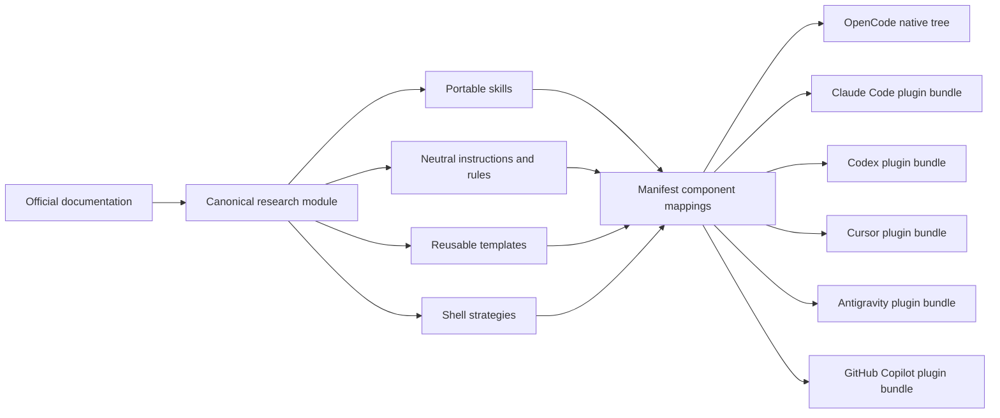

# Portable Capability Scaffolds

This module is the canonical research record for the capability layer of the portable agent ecosystem. It defines how language, SDK, shell, media, data, container, and general workflow support is represented without vendoring tools, installing dependencies, or copying agent-specific manifest keys into canonical assets.

Agent discovery paths, plugin formats, and GUI/CLI sharing rules are defined in [Agent native ecosystem layouts](agent-native-ecosystem-layouts.md). Repository health files are defined in [GitHub repository foundations](github-repository-foundations.md). DCM status semantics are defined in [Dynamic Context Manager](dynamic-context-manager.md).

## Scope

The capability layer is intentionally general. It covers any repeatable workflow that benefits from agent support, including:

- code editing, refactoring, review, testing, and debugging;
- documentation, research, planning, and handoff;
- data and file processing;
- image, audio, and video manipulation;
- shell automation and command planning;
- language, framework, SDK, and package-manager onboarding;
- web and API integration;
- capability, rule, template, plugin, and automation authoring.

The named technologies below are representative research-backed examples, not a closed list. New capabilities follow the same scaffold contract after official documentation is checked.

## Capability model

Canonical assets stay agent-neutral. Adapter fragments add the frontmatter, file extensions, and destination paths required by each agent. This preserves one source of truth while producing native layouts.

## Skill scaffold contract

A portable skill is a directory with a required `SKILL.md` that carries `name` and `description` frontmatter. The folder name matches the `name` value. Optional `scripts/`, `references/`, and `assets/` directories hold executable examples, canonical links, and reusable resources.

| Directory | Purpose | Repository policy |
|---|---|---|
| `SKILL.md` | Trigger description and portable procedure. | Required; concise and progressively disclosed. |
| `scripts/` | Example or helper scripts. | Placeholder only in this repository; no bundled runtimes or dependency installs. |
| `references/` | Pointers to canonical documentation. | Links back to this research module instead of duplicating volatile facts. |
| `assets/` | Templates and reusable resources. | Placeholder only unless a portable text asset adds clear value. |

Scaffolds must not assume a host platform, absolute path, installed runtime, or credential-bearing example. Destructive or in-place operations require an explicit safety gate before execution.

## Official sources

All sources were accessed on 2026-11-25. URLs are cited exactly; summaries record only the facts used by this repository.

### Scaffold and automation formats

| # | URL | Facts supported |
|---|---|---|
| 1 | https://agentskills.io/specification | Skills require `SKILL.md` with YAML `name` and `description`; `name` matches the parent directory; optional `scripts/`, `references/`, and `assets/` directories are supported. |
| 2 | https://code.claude.com/docs/en/skills.md | Skills are loaded progressively when relevant, making longer reusable procedure scaffolds practical. |
| 3 | https://code.claude.com/docs/en/hooks.md | Hooks can be shell commands, HTTP endpoints, MCP tool calls, prompts, or subagents attached to lifecycle events. They are represented as neutral automation scaffolds only. |
| 4 | https://antigravity.google/docs/skills/ | Focused scope, clear descriptions, progressive disclosure, black-box scripts, and decision trees are recommended skill-design principles. |
| 5 | https://antigravity.google/docs/sdk/overview/ | The Antigravity SDK covers tool execution, context management, safety policies, subagents, MCP, structured output, and lifecycle hooks. It informs neutral notes only; no SDK is installed or credential example copied. |
| 6 | https://opencode.ai/docs/agents/ | OpenCode V2 agents use Markdown frontmatter with `mode` values `primary`, `subagent`, or `all`; permission rules are ordered and the last matching rule wins. |

### Languages and runtimes

| # | URL | Facts supported |
|---|---|---|
| 7 | https://nodejs.org/docs/latest/api/ | Node documents built-in `node:` modules and APIs such as `fs`, `path`, `child_process`, `url`, and `test`, supporting dependency-free scaffolds. |
| 8 | https://docs.python.org/3/tutorial/index.html | The Python tutorial covers data structures, modules, file I/O, errors, classes, and the standard library. |
| 9 | https://go.dev/doc/ | Go documentation links the language specification, user guide, standard library, Effective Go, modules, and release notes. |
| 10 | https://www.typescriptlang.org/docs/ | TypeScript documentation covers handbook topics, everyday types, narrowing, functions, objects, generics, modules, and tooling. |
| 11 | https://doc.rust-lang.org/book/ | The Rust book covers ownership, structs, enums, modules, generics, traits, collections, error handling, concurrency, and Cargo. The fetched edition assumes a recent toolchain and edition 2024; scaffolds stay version-tolerant. |
| 12 | https://docs.oracle.com/javase/tutorial/ | The Java Tutorials provide learning paths for Java language and platform concepts. |
| 13 | https://learn.microsoft.com/en-us/dotnet/csharp/ | The C# guide provides tutorials, samples, language reference, and specifications for .NET workflows. |
| 14 | https://docs.ruby-lang.org/en/master/ | Ruby documentation indexes core classes and modules such as `String`, `Array`, `Hash`, `Enumerable`, `File`, `IO`, `Time`, `Regexp`, and `Thread`. |
| 15 | https://www.php.net/manual/en/ | The PHP manual covers getting started, language reference, security, language features, and extension tooling. |
| 16 | https://en.cppreference.com/w/cpp | The C++ reference indexes language rules, standard library, headers, named requirements, compiler support, and feature-test macros. |
| 17 | https://en.cppreference.com/w/c | The C reference indexes language rules, headers, type support, utilities, variadic functions, error handling, memory, strings, algorithms, numerics, and date/time facilities. |
| 18 | https://kotlinlang.org/docs/home.html | Kotlin Docs is the canonical documentation entry point. |
| 19 | https://raw.githubusercontent.com/JetBrains/kotlin-web-site/master/docs/topics/home.topic | Kotlin's official documentation source lists syntax, the Kotlin tour, Multiplatform, standard library API, Gradle, Maven, collections, and coroutines. |
| 20 | https://docs.swift.org/swift-book/documentation/the-swift-programming-language/ | The Swift book is the canonical language reference location; the rendered page redirects to the current documentation site. |
| 21 | https://raw.githubusercontent.com/swiftlang/swift-book/main/TSPL.docc/The-Swift-Programming-Language.md | The official Swift book source indexes fundamentals, strings, collections, control flow, functions, closures, enumerations, classes and structures, concurrency, macros, protocols, generics, ARC, memory safety, and access control. |

### Package managers and build systems

| # | URL | Facts supported |
|---|---|---|
| 22 | https://docs.npmjs.com/ | npm documentation covers dependency management, configuration, CLI commands, security, and publishing workflows. |
| 23 | https://pip.pypa.io/en/stable/ | pip documentation covers installation, user guides, caching, dependency resolution, configuration, repeatable installs, secure installs, and VCS support. |
| 24 | https://doc.rust-lang.org/cargo/ | Cargo downloads dependencies, compiles, packages, and publishes Rust crates. |
| 25 | https://go.dev/doc/modules | Go modules documentation covers module-based dependency and build workflows. |
| 26 | https://maven.apache.org/guides/index.html | Maven guides index the user manual, repositories, plugins, extensions, and tooling. |
| 27 | https://docs.gradle.org/current/userguide/userguide.html | The Gradle user manual covers builds, supported languages, build scripts, plugins, and provides Markdown-oriented documentation for AI agents. |

### Media, data, container, and command-line tools

| # | URL | Facts supported |
|---|---|---|
| 28 | https://imagemagick.org/command-line-tools/ | ImageMagick documents `magick`, `identify`, and `mogrify`; in-place operations require overwrite safety guidance. |
| 29 | https://ffmpeg.org/documentation.html | FFmpeg documents `ffmpeg`, `ffplay`, and `ffprobe` for inspection, conversion, and playback. |
| 30 | https://jqlang.github.io/jq/manual/ | jq documents filters, invocation forms, input/output options, and quoting behavior. |
| 31 | https://www.postgresql.org/docs/current/ | PostgreSQL documentation covers current and development versions and database workflow material. |
| 32 | https://www.sqlite.org/docs.html | SQLite documentation links SQL syntax, pragmas, functions, C interfaces, and the command-line shell. |
| 33 | https://docs.docker.com/ | Docker documentation covers Desktop, Engine, Build, Compose, sandboxes, AI governance, Testcontainers, Scout, and hardening. |
| 34 | https://curl.se/docs/manpage.html | curl documents protocols, authentication, cookies, configuration, timeouts, uploads, and TLS controls. |
| 35 | https://github.com/BurntSushi/ripgrep/blob/master/README.md | ripgrep is recursive, gitignore-aware, regex-capable, and supports file and type filters. |
| 36 | https://pubs.opengroup.org/onlinepubs/9699919799/utilities/contents.html | The Open Group Base Specifications provide the authoritative POSIX Shell & Utilities index. |
| 37 | https://learn.microsoft.com/en-us/powershell/scripting/overview?view=powershell-7.5 | PowerShell is cross-platform on Windows, macOS, and Linux. |
| 38 | https://learn.microsoft.com/en-us/powershell/module/microsoft.powershell.core/about/about_quoting_rules?view=powershell-7.5 | PowerShell quoting distinguishes expandable double quotes, verbatim single quotes, here-strings, and safe handling of untrusted arguments. |
| 39 | https://git-scm.com/docs/git | Git supports `git -C <path>`, `--no-pager`, environment-based config, porcelain/plumbing commands, and read-only inspection commands. |

## Language and tool coverage matrix

| Category | Scaffold families | Canonical documentation | Installer treatment |
|---|---|---|---|
| Scripting and runtime | Node.js, Python | Sources 7-8 | Copied as portable skills; no runtime installation. |
| Compiled and typed | Go, TypeScript, Rust, Java, C#, Ruby, PHP, C/C++, Kotlin, Swift | Sources 9-21 | Version-tolerant onboarding and workflow guidance. |
| Package and build | npm, pip, Cargo, Go modules, Maven, Gradle | Sources 22-27 | Command planning separated from language semantics. |
| Media | ImageMagick, FFmpeg | Sources 28-29 | Inspection and conversion first; in-place operations gated. |
| Data | jq, PostgreSQL, SQLite | Sources 30-32 | Query and validation guidance; no credentials or live connections. |
| Containers | Docker | Source 33 | Build, Compose, and hardening guidance; no runtime installation. |
| Shell and search | curl, ripgrep, POSIX shell, PowerShell, Git | Sources 34-39 | Cross-platform quoting, timeouts, read-only inspection, and destructive-action gates. |

## Shell strategy rules

1. Choose the shell syntax for the host and state the assumption before running commands.
2. Prefer dedicated file-search and read tools over shell text processing when available.
3. Keep commands single-purpose; avoid chaining unless every stage is understood.
4. Quote paths and arguments according to the active shell. In PowerShell, use single quotes for verbatim text, double quotes only for intentional expansion, and here-strings for multi-line content.
5. Never place untrusted arguments directly into shell blocks or generated command strings.
6. For Git, prefer `git -C <path>`, `--no-pager`, and explicit read-only inspection commands. Treat mutating and remote commands as authorization-gated.
7. For package managers, inspect the manifest and lockfile before selecting install, update, or publish operations.
8. For media tools, inspect first with read-only tools such as `identify` or `ffprobe`; require an explicit gate before in-place or overwrite operations.
9. For data tools, prefer dry inspection, schema-aware queries, and validation before writes. Do not embed credentials in commands or scaffolds.
10. For network tools, set timeouts and treat authentication, cookies, and uploads as sensitive operations.
11. Long-running jobs use a non-blocking execution mode; interactive or GUI-blocking tools are avoided during automated validation.

## Automation and SDK boundaries

Hook scaffolds describe possible lifecycle triggers without installing hooks. Agent-specific hook schemas belong in adapters. SDK notes describe capabilities such as tools, context, safety, subagents, MCP, structured output, and hooks at a conceptual level; no SDK installation, credentialed call, or API-key example is part of the repository.

OpenCode V2 agent scaffolds use V2 frontmatter only. `mode` is limited to `primary`, `subagent`, or `all`, and permission rules are ordered because the last matching rule wins.

Capability scaffolds do not define DCM status semantics; consumers link to [Dynamic Context Manager](dynamic-context-manager.md) for current-versus-cumulative context and complete-status behavior.

## Research limitations

- The web search integration returned HTTP 402 for some queries, so official documentation was fetched directly.
- A direct fetch of the GNU Bash manual failed with a transport error. Bash-specific claims are therefore not cited here; POSIX guidance comes from the authoritative Shell & Utilities index, and PowerShell guidance comes from Microsoft documentation.
- Kotlin and Swift rendered pages required HTML or upstream-source follow-up because lightweight rendering did not expose usable body content. Their official upstream sources are cited above.
- Rust documentation versions move quickly. Scaffolds must avoid hardcoding a toolchain version as a repository-wide requirement.

## Consumer guidance

- [README](../../../README.md) links to this module for the capability overview.
- [Installation](../../user/installation.md) explains installer behavior, not scaffold internals.
- [Scope and collision policy](../../user/scope-and-collision-policy.md) explains destination and overwrite behavior.
- [Architecture](../architecture.md) explains the canonical-source-to-adapter flow.
- [Adapter authoring](../adapter-authoring.md) explains how to add a new agent-specific destination for a capability scaffold.
- [Testing](../testing.md) verifies that scaffolds remain portable and dry-run-only.
