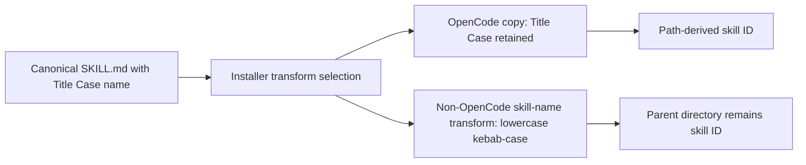

# Skill Display Labels

This module is the canonical research record for skill frontmatter labels. It defines why canonical skill files use OpenCode's Title Case display labels and how the installer emits supported `name` values for other agents.

Skill discovery paths and plugin formats are defined in [Agent native ecosystem layouts](agent-native-ecosystem-layouts.md). The portable skill scaffold contract is defined in [Portable capability scaffolds](portable-capability-scaffolds.md).

## Scope

A skill has two distinct identifiers:

| Concept | Storage | Stability | Purpose |
|---|---|---|---|
| Skill ID | Parent directory name | Stable across agents | Exact path-derived identifier used by loaders, mentions, and permissions. |
| Display label | Frontmatter `name` | Agent-specific | Human-readable title or slash-command name shown by an agent. |

Canonical sources are written in OpenCode's supported format. That makes Title Case labels the project default while leaving the directory name as the portable ID.

## Agent support matrix

| Agent family | Expected frontmatter `name` | Installer behavior |
|---|---|---|
| OpenCode | Human-readable display label; IDs are path-derived. | Copy canonical files unchanged. |
| Claude Code | Slash-command name; defaults to the directory name. | Rewrite `name:` to the parent directory name. |
| Codex / Agent Skills | Lowercase alphanumeric and hyphen identifier matching the parent directory. | Rewrite `name:` to the parent directory name. |
| Cursor | Lowercase kebab-case identifier. | Rewrite `name:` to the parent directory name. |
| Google Antigravity | Lowercase hyphenated identifier. | Rewrite `name:` to the parent directory name. |
| GitHub Copilot | Lowercase hyphenated skill name. | Rewrite `name:` to the parent directory name. |

## Transform contract

The `skill-name` transform applies only to `SKILL.md` files inside a skill component. It replaces the frontmatter `name:` value with the skill's parent directory name and preserves the remainder of the file. Non-`SKILL.md` assets are copied unchanged.

The transform intentionally does not rename directories. Path-derived IDs, `@skill-id` mentions, permission rules, and adapter component paths remain stable.

## Official sources

All sources were accessed on 2026-11-26. URLs are cited exactly; summaries record only the facts used by this repository.

| # | URL | Facts supported |
|---|-----|-----------------|
| 1 | https://opencode.ai/docs/skills | OpenCode skills use frontmatter and path-derived skill IDs; `name` is a display label. |
| 2 | https://agentskills.io/specification | `name` is a lowercase alphanumeric and hyphen identifier that matches the parent directory. |
| 3 | https://code.claude.com/docs/en/skills | Claude Code skill names become slash-command names and default to directory names. |
| 4 | https://cursor.com/docs/context/skills | Cursor requires lowercase kebab-case skill names. |
| 5 | https://antigravity.google/docs/skills | Antigravity skill names are lowercase and hyphenated. |
| 6 | https://learn.chatgpt.com/docs/build-skills.md | Codex skills follow the Agent Skills convention. |
| 7 | https://docs.github.com/en/copilot/concepts/customizations/agent-skills | Copilot Agent Skills use lowercase hyphenated names. |

## Compatibility note

Canonical Title Case labels are a deliberate OpenCode-first choice. Other agents receive their supported casing through the installer rather than through a second hand-maintained source tree. Any new adapter must declare an explicit skill transform if its discovered `name` rules differ from OpenCode's.

## Verification

- Canonical sources must contain the approved Title Case labels.
- OpenCode destinations must retain canonical labels.
- Non-OpenCode destinations must contain lowercase kebab-case labels equal to their parent directories.
- Directory names and all ID-based references must remain unchanged.
