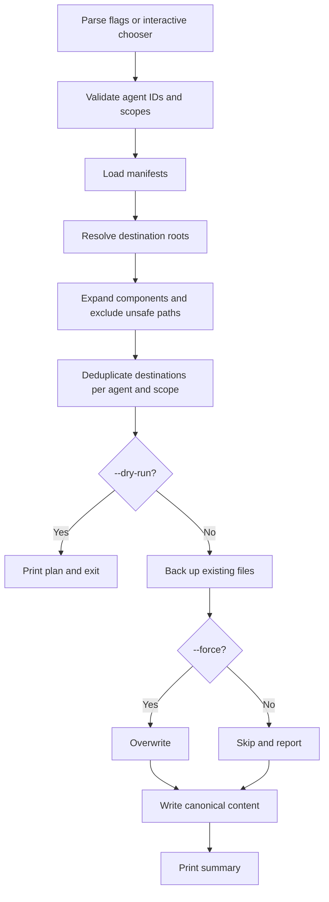

# Installation

The installer restores canonical agent assets into native OpenCode V2, Claude Code, Codex, Cursor, Google Antigravity, and GitHub Copilot layouts. It supports global, local, and per-agent mixed scope, and treats each agent's GUI and CLI surfaces as one native configuration per scope.

For authoritative discovery paths and plugin formats, see [Agent native ecosystem layouts](../developer/research/agent-native-ecosystem-layouts.md). For DCM status semantics, see [Dynamic Context Manager](../developer/research/dynamic-context-manager.md).

## Prerequisites

- Node.js 18 or newer.
- A writable target directory for the selected scope.
- No credential-bearing files in the source tree; those are excluded before any read.

The installer uses only built-in `node:` modules and has no dependency installation step.

## Commands

Run commands from the repository root.

```bash
node scripts/install.mjs --help
node scripts/install.mjs --dry-run
node scripts/install.mjs --dry-run --agent all --scope global
node scripts/install.mjs --dry-run --agent opencode,claude-code --scope local --project ./example-project
node scripts/install.mjs --dry-run --global-agent opencode,codex --local-agent cursor,antigravity --project ./example-project
```

Remove `--dry-run` only when you intend to write to the resolved native destinations.

## Options

| Option | Argument | Behavior |
|---|---|---|
| `--agent` | Comma-separated agent IDs or `all` | Applies one scope to the listed agents. Repeatable. |
| `--scope` | `global` or `local` | Scope used with `--agent`. Defaults to `global`. |
| `--global-agent` | Comma-separated agent IDs | Installs the listed agents at global scope. |
| `--local-agent` | Comma-separated agent IDs | Installs the listed agents at local scope. |
| `--project` | Directory path | Project root for local scope. Defaults to the current working directory. |
| `--dry-run` | None | Prints the full write plan without changing the filesystem. |
| `--force` | None | Allows overwrite of existing files after backup. Without it, existing files are skipped. |
| `--help` | None | Prints usage and exits. |

When no agent-selection option is provided, the installer starts an interactive chooser for agents and scope.

## Supported agent IDs

| ID | Product | Surfaces reported |
|---|---|---|
| `opencode` | OpenCode V2 | CLI/TUI and Desktop GUI |
| `claude-code` | Claude Code | CLI, Desktop, VS Code, JetBrains |
| `codex` | Codex | CLI, App, IDE |
| `cursor` | Cursor | Editor and CLI |
| `antigravity` | Google Antigravity | App, CLI, IDE |
| `github-copilot` | GitHub Copilot | CLI, IDE, Editor |

GUI and CLI surfaces are reported for validation but are not installed twice. The installer writes one native tree per agent and scope.

## Install flow



## Mixed scope example

```bash
node scripts/install.mjs \
  --global-agent opencode,codex \
  --local-agent cursor,antigravity \
  --project ./example-project \
  --dry-run
```

This installs OpenCode and Codex into their global native locations and Cursor and Antigravity into the project's local native folders. Claude Code is not selected.

## Dry-run output

A dry-run reports, for each component:

- selected agent and scope;
- resolved destination path;
- source unit;
- action: `create`, `skip`, `overwrite`, or `excluded`;
- collision status when a destination already exists;
- surfaces reported for the agent.

Dry-run performs no writes, no backups, and no deletion.

## Safety notes

- Credential-bearing paths are excluded by name before any filesystem read.
- The OpenCode V2 DCM implementation (`dynamic-context-manager`) is emitted only for `opencode`; other agents receive native DCM fragments.
- No absolute machine path is written into generated config; templates use install-time substitution.
- Repository initialization, commits, and remote operations are not performed by the installer.

For collision details and backup naming, see [Scope and collision policy](scope-and-collision-policy.md).
