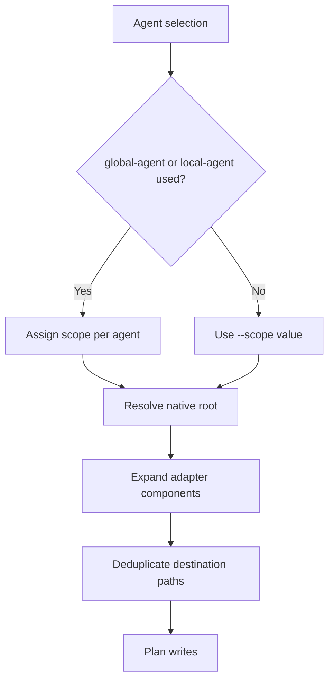

# Scope and Collision Policy

This document explains how the installer chooses destinations and protects existing files. Native discovery paths are defined in [Agent native ecosystem layouts](../developer/research/agent-native-ecosystem-layouts.md). DCM boundary details are in [Dynamic Context Manager](../developer/research/dynamic-context-manager.md), and packaging limits are in [GitHub Copilot and package distribution](../developer/research/github-copilot-and-package-distribution.md).

## Scope model

| Scope | Destination base | Typical use |
|---|---|---|
| Global | Agent-specific user home directory | Restore personal configuration and components for all projects. |
| Local | Project-relative native folders | Restore workspace configuration for one project. |
| Mixed | Per-agent choice of global or local | Restore different agents into different scopes in one run. |

Select global scope with `--scope global` or `--global-agent`. Select local scope with `--scope local` or `--local-agent`. When both per-agent lists are used, they take precedence over `--scope`.

## One install per agent and scope

Official documentation confirms that each supported agent's GUI and CLI surfaces share the same native configuration where applicable. The installer therefore:

1. reads the agent's `surfaces` list from its adapter manifest;
2. reports those surfaces in the plan output;
3. writes each destination path only once;
4. does not create a second copy for a GUI surface.

This prevents drift between a CLI-only edit and a GUI-only edit.

## Destination resolution

| Input | Resolution rule |
|---|---|
| OpenCode global | `OPENCODE_CONFIG_HOME` when set; otherwise the platform config home plus `opencode`. |
| Codex global | `CODEX_HOME` when set; otherwise the user home plus `.codex`. |
| Copilot global | `COPILOT_HOME` when set; otherwise the user home plus `.copilot`. |
| Other global roots | Derived from the user home with standard agent directories. |
| Local root | `--project` when supplied; otherwise the current working directory. |
| Environment overrides | Read at run time and never written into tracked config files. |

## Collision states

| State | Condition | Default action | With `--force` |
|---|---|---|---|
| `create` | Destination does not exist. | Write. | Write. |
| `skip` | Destination exists and `--force` is absent. | Back up, then skip. | Not applicable. |
| `overwrite` | Destination exists and `--force` is present. | Not applicable. | Back up, then overwrite. |
| `excluded` | Source path matches an exclusion rule. | Do not read or write. | Do not read or write. |

### Backup behavior

Before any change to an existing file, the installer creates a timestamped backup beside the destination. Backup names include a monotonic suffix when multiple backups occur in the same second.

Backups are not deleted by the installer. They are reported in the plan and summary so the user can decide what to keep.

### Why skip is the default

Agent configuration is often edited by interactive surfaces. Skipping existing files prevents an install from silently replacing user work. `--force` is an explicit opt-in that still preserves a backup.

## Exclusion rules

The installer excludes a source before reading it when the path indicates any of the following:

- credential-bearing service configuration;
- environment value files;
- cookie or credential exports;
- token, password, or secret files.

Exclusion is path-based. Tracked documentation may discuss these categories using placeholder names, but no values are ever copied or printed.

## Agent-specific boundaries

| Agent | Boundary |
|---|---|
| OpenCode V2 | The DCM implementation `dynamic-context-manager` is emitted only for `opencode`. GUI plugins use the experimental export declared in the adapter. |
| Claude Code | One `~/.claude/` or project `.claude/` tree serves CLI and graphical surfaces. |
| Codex | `CODEX_HOME` relocation is resolved at run time; config templates never contain a fixed absolute home. |
| Cursor | User rules are managed in the UI, so global rule files are not silently created. Local rules use `.cursor/rules/*.mdc`. |
| Antigravity | Generated rules include valid YAML `trigger` frontmatter. Plugin manifest keys are case-sensitive. |
| GitHub Copilot | Local fragments resolve under `.github/copilot`; global settings resolve under `~/.copilot` or `COPILOT_HOME`. Internal `config.json` and installed-plugin state are read-only sources, not install targets. |

## Validation boundary

During repository validation, only `--dry-run` is used. No installed global configuration, plugin, agent, command, template, or setting is modified. Writing to native destinations requires an explicit separate run without `--dry-run`.
